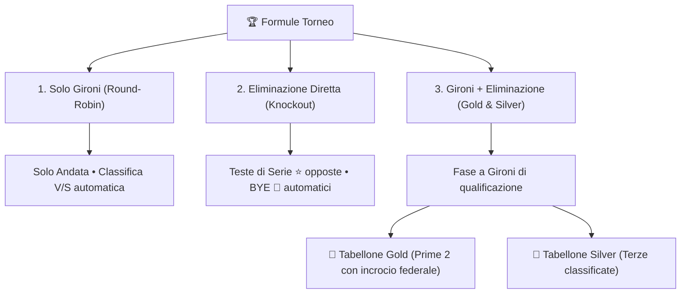
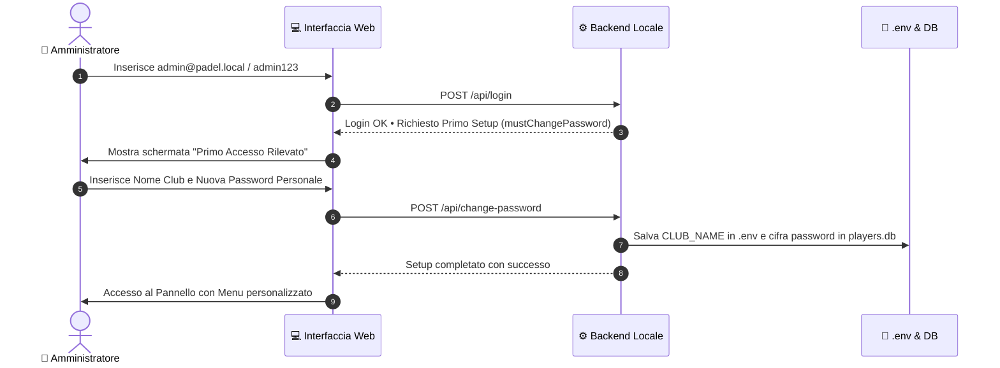

<p align="center">
  
  
  
  
  
  
</p>

<h1 align="center">🏆 Gestione Tornei Padel</h1>

<p align="center">
  <strong>Software professionale e portatile per l'organizzazione e la gestione di tornei di padel.</strong><br/>
  100% offline, nessun database esterno da configurare, ideale per circoli sportivi ed eseguibile direttamente da <strong>chiavetta USB</strong>.
</p>

<p align="center">
  <a href="ISTRUZIONI.md"><strong>📖 GUIDA COMPLETA &amp; MANUALE UTENTE (ISTRUZIONI.md)</strong></a><br/><br/>
  <a href="#-panoramica">Panoramica</a> •
  <a href="#-formule-di-torneo">Formule Torneo</a> •
  <a href="#-schermo-tv--vista-live-pubblica">Vista TV Live</a> •
  <a href="#-primo-accesso--sicurezza">Primo Accesso</a> •
  <a href="#-avvio-rapido-in-1-clic">Avvio Rapido</a> •
  <a href="#%EF%B8%8F-architettura--tecnologie">Tech Stack</a> •
  <a href="#-struttura-del-progetto">Struttura</a>
</p>

---

> [!NOTE]
> **Edizione Focalizzata sui Tornei:**  
> In questa versione, i moduli per la prenotazione oraria dei campi, la timeline slot, le lezioni academy e i report mensili sono stati disattivati e commentati nel codice sorgente per offrire uno strumento super veloce, leggero, senza dipendenze cloud e focalizzato esclusivamente sull'organizzazione impeccabile dei **tornei di padel**.

---

## ⚡ Panoramica & Vantaggi

- **💾 100% Locale & Offline:** Funziona senza connessione internet. Nessun server cloud da pagare, nessun servizio esterno.
- **📁 Database File Integrato (NeDB):** I dati (tornei, gironi, match, coppie, utenti) vengono salvati in file testuali leggeri nella cartella `backend/data/*.db`. Non serve installare né configurare MongoDB o MySQL.
- **🚀 Portatile su Pen Drive USB:** Puoi copiare l'intera cartella su una chiavetta USB e avviarla su qualsiasi computer Windows, Mac o Linux.
- **🔄 Auto-Setup Completo & Rilevamento Node.js (Windows, Mac e Linux):** Gli script di avvio verificano automaticamente la presenza di Node.js. Se manca, avviano il download e l'installazione, verificano le dipendenze e compilano il frontend in autonomia.
- **📺 Tabellone TV & Live Spettatori:** Pagina pubblica protetta in sola lettura (`/live`), ideale per proiettare i risultati in tempo reale sulla TV della club house o permettere ai giocatori di seguire i match dallo smartphone.

---

## 🎾 Formule di Torneo Supportate

L'applicazione gestisce le 3 formule sportive più diffuse nei club:



### 1. 🏆 Solo Gironi (All'italiana - Sola Andata)
- Ogni coppia affronta ciascuna delle altre coppie del proprio girone **una sola volta** (nessun match di ritorno).
- Classifica aggiornata in tempo reale all'inserimento di ogni risultato con vittorie ($V$), sconfitte ($S$) e posizione.
- Visualizzazione chiara e compatta dei cognomi con tooltip per leggere i nomi completi dei giocatori.

### 2. ⚡ Eliminazione Diretta (con Teste di Serie e BYE Automatici)
- **Gestione Teste di Serie (⭐):** Le coppie con seed vengono posizionate automaticamente alle estremità opposte del tabellone (la #1 in cima e la #2 in fondo) in modo che possano affrontarsi solo in finale.
- **Risoluzione Automatica dei BYE:** Se il numero di coppie non è una potenza di 2 (es. 10 coppie in un tabellone da 16):
  - Il tabellone non presenta buchi o partite vuote.
  - Le migliori coppie/teste di serie ricevono automaticamente il passaggio del turno (**`BYE 🚀`**) e vengono proiettate direttamente ai Quarti di Finale.
  - I restanti team disputano gli Ottavi, completando alla perfezione il tabellone.

### 3. 🥇🥈 Gironi + Eliminazione Diretta (Fase Gold & Silver)
- **Fase 1 (Gironi):** Qualificazioni all'italiana con classifica sempre aggiornata.
- **Fase 2 (Generazione Automatica con 1 Clic):**
  - **Tabellone Gold 🥇:** Vi accedono le prime 2 classificate di ogni girone con **incrocio federale automatico** (1°A vs 2°B, 1°B vs 2°A) per evitare che squadre dello stesso girone si riaffrontino al primo turno ad eliminazione.
  - **Tabellone Silver 🥈:** Vi accedono le terze classificate per garantire a tutti i giocatori un torneo completo e avvincente.
- Possibilità di rigenerare o aggiornare i tabelloni in caso di modifiche ai risultati dei gironi.

---

## 📺 Schermo TV & Vista Live Pubblica (`/live`)

Una schermata dedicata esclusivamente agli spettatori e ai giocatori, progettata per essere proiettata sui monitor o sulle Smart TV del circolo:

- **100% Sola Lettura (Zero Rischi):** Nessun pulsante di modifica, eliminazione o inserimento score. Chiunque visualizzi la pagina non può manomettere i dati del torneo.
- **Aggiornamento Live Automatico (15s):** Polling automatico in tempo reale. Non appena l'organizzatore inserisce un risultato nel pannello admin, il tabellone sullo schermo TV si aggiorna da solo senza dover ricaricare la pagina.
- **Modalità Fullscreen (⛶):** Con un solo tocco entra a tutto schermo eliminando le barre del browser.
- **Accessibile senza Login:** Tramite link locale/Wi-Fi (es. `http://192.168.1.xxx:4000/live`), chiunque sia connesso alla rete del club può seguire il tabellone dal proprio smartphone.

---

## 🔐 Primo Accesso & Personalizzazione Club

All'avvio, l'applicazione dispone di credenziali di fabbrica:
- **Email:** `admin@padel.local`
- **Password iniziale:** `admin123`



1. **Rilevamento Automatico:** Al primo accesso, l'app intercetta le credenziali di fabbrica e apre la schermata di configurazione iniziale.
2. **Nome del Club:** Viene richiesto il nome del circolo (es. *Padel Club Roma*), che viene scritto automaticamente nella variabile `CLUB_NAME` del file `backend/.env`.
3. **Nuova Password:** Viene impostata e cifrata la password personale dell'amministratore, disattivando definitivamente `admin123`.
4. **Personalizzazione Immediata:** Il nome del circolo comparirà subito nel logo `🎾 [Nome Club]`, nel pulsante `🏆 Gestione Tornei • [Nome Club]` e in tutti i tabelloni.
5. **Modifiche Future:** Dal pulsante **`⚙️ Impostazioni`** nella barra superiore, l'amministratore può modificare il nome del circolo e la password in qualsiasi momento.

---

## 🚀 Avvio Rapido (in 1 Clic)

Entrambi gli script sono progettati per funzionare **al primo colpo senza configurazioni manuali**: controllano la presenza di Node.js, installano le dipendenze se mancanti, compilano il frontend e aprono automaticamente il browser.

### 💻 Su Windows
Fai doppio clic sul file:
```cmd
start-local.bat
```
- Controlla se Node.js è presente; se manca, scarica e installa automaticamente la versione LTS ufficiale da `nodejs.org` in background.
- Verifica le dipendenze (`backend/node_modules/` e `frontend/dist/`).
- Avvia il server e apre il browser all'indirizzo **`http://localhost:4000/login`**.

### 🍎 Su Mac e Linux
Apri il terminale nella cartella del progetto (oppure fai doppio clic da Finder su macOS) ed esegui:
```bash
./start-local.sh
```
- Include automaticamente i percorsi di sistema (`/usr/local/bin`, `/opt/homebrew/bin`, `nvm`).
- Se Node.js non è installato:
  - **Su macOS:** lo installa via Homebrew oppure scarica l'installer ufficiale `.pkg` e avvia la procedura guidata di Apple.
  - **Su Linux:** tenta l'installazione automatica tramite il gestore di pacchetti (`apt`, `dnf` o `pacman`).
- Installa le dipendenze, compila il frontend se necessario e apre automaticamente il browser con `open` (macOS) o `xdg-open` (Linux).

---

## 🛠️ Architettura & Tecnologie

| Layer | Componente | Descrizione |
| :--- | :--- | :--- |
| **Frontend** | React 18, Vite 7, TailwindCSS 3 | Interfaccia responsive, dark/light contrast, animazioni e visualizzatore tabelloni |
| **Backend** | Node.js, Express | Server API REST locale, gestione incroci, esportazione immagini e configurazione |
| **Database** | NeDB (embedded) | Database NoSQL su file leggeri e portabili (`backend/data/*.db`) |
| **Autenticazione** | JWT + bcryptjs | Token di sessione e cifratura sicura delle password |
| **Export Grafico** | html2canvas | Esportazione dei tabelloni in immagini PNG ad alta risoluzione |

---

## 📂 Struttura del Progetto

```text
PC-PadelProject/
├── start-local.bat             # Avvio automatico per Windows (con auto-setup e installazione Node.js)
├── start-local.sh              # Avvio automatico per Mac / Linux (con auto-setup e verifica Node.js)
├── ISTRUZIONI.md               # Manuale utente completo e guida per chiavetta USB
├── README.md                   # Questa documentazione
│
├── backend/
│   ├── data/                   # Cartella del database locale (file .db)
│   │   ├── tournaments.db      # Tornei, gironi, match e tabelloni
│   │   ├── players.db          # Amministratore e giocatori (password cifrate)
│   │   └── courts.db           # Configurazione campi
│   ├── config.js               # Parametri di configurazione (orari, campi)
│   ├── server.js               # API Express, logica tornei, sorteggi e KO
│   └── .env                    # Variabili d'ambiente (CLUB_NAME, PORT, JWT_SECRET)
│
└── frontend/
    ├── src/
    │   ├── pages/
    │   │   ├── AdminTournaments.jsx # Gestione completa tornei, coppie, risultati
    │   │   ├── PublicTournament.jsx # Vista Schermo TV / Live pubblica (sola lettura)
    │   │   └── Login.jsx            # Accesso admin e schermata primo setup
    │   ├── components/
    │   │   ├── NavBar.jsx           # Barra di navigazione con impostazioni club e password
    │   │   └── SponsorFooter.jsx    # Footer sponsor
    │   └── hooks/
    │       └── useConfig.js         # Hook reattivo per la configurazione del club
    └── dist/                        # Build compilata e pronta all'uso offline
```

---

## 📡 API Endpoints Principali

### 🔒 Autenticazione & Setup
- `POST /api/login` — Accesso amministratore (restituisce `mustChangePassword` se al 1° login)
- `POST /api/change-password` — Cambio password e aggiornamento del nome club in `.env`
- `PUT /api/admin/club-name` — Aggiornamento rapido del nome del circolo
- `GET /api/config` — Configurazione attiva del club

### 🏆 Tornei (Admin)
- `GET /api/tournaments` — Elenco tornei con dati popolati
- `POST /api/tournaments` — Creazione nuovo torneo
- `POST /api/tournaments/:id/couples` — Aggiunta coppie singole o batch
- `POST /api/tournaments/:id/draw` — Sorteggio gironi o tabellone a eliminazione diretta
- `POST /api/tournaments/:id/generate-knockout` — Generazione tabelloni Gold e Silver
- `PUT /api/tournaments/:id/matches/:matchId` — Salvataggio punteggio e avanzamento vincitore

### 📺 Vista Pubblica (Sola Lettura)
- `GET /api/public/tournaments` — Elenco tornei per monitor e spettatori (senza autenticazione)
- `GET /api/public/tournaments/:id` — Dettaglio torneo in tempo reale (senza autenticazione)

---

## 📄 Note di Versione

> I componenti relativi a prenotazioni campi, slot timeline, lezioni coach, reportistica economica mensile e notifiche email sono conservati nel codice sorgente e commentati. Possono essere ripristinati in qualsiasi momento qualora si desideri ritrasformare l'applicazione in una suite gestionale completa con database MongoDB.

---

<p align="center">
  Realizzato per la community del Padel 🎾 • Gestione Tornei Facile, Veloce e Portatile
</p>
